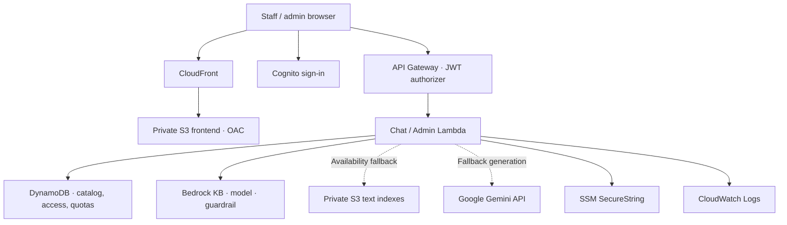

# Thinking AI

**Turn approved department documents into clear, cited answers.**

Thinking AI is an authenticated document assistant for HR, Cloud, GenAI and custom teams. Administrators publish documents and manage access; staff ask questions within their department’s knowledge.

Amazon Bedrock is the primary retrieval and generation path. When it is unavailable, a private text index and the configured Google Gemini model provide a fallback.

[](https://github.com/sakthisaravanan8531-hue/thinking-ai/actions/workflows/workspace.yml)


[Team workspace](https://d3nv2zhw5ihk84.cloudfront.net/) · [Admin workspace](https://d3nv2zhw5ihk84.cloudfront.net/admin.html) · [Editable architecture](docs/Thinking-AI-Architecture.drawio) · [Deployment guide](docs/BEDROCK-FALLBACK.md)

> Access requires an account assigned by an administrator. Deployment scripts currently target this project's existing AWS account and resources; they are not a one-command installer for a new account.

## Why

Teams need answers from approved material without exposing another department’s documents or giving every employee upload access.

| Need | Thinking AI |
| --- | --- |
| Find information in team documents | Ask a question and receive document citations |
| Keep departments separate | Staff must belong to exactly one active department |
| Control published knowledge | Admin-only upload, indexing and deletion |
| Keep working during Bedrock availability failures | Department-scoped text retrieval and Gemini fallback |
| Handle common spelling mistakes | Conservative matching against indexed document vocabulary |
| Keep account administration in one place | Manage users, roles and departments through the admin portal |

## Features

- **Department-scoped answers** — retrieve only approved sources assigned to the signed-in staff member’s department.
- **Document topic explanations** — explain topics mentioned in approved documents, with labeled background information; decline unrelated questions.
- **Separate staff and admin portals** — Cognito app clients and server-side role checks enforce the distinction.
- **Admin document publishing** — PDF, DOCX, UTF-8 TXT and Markdown uploads up to 50 MiB, assigned to one or more teams.
- **Independent department copies** — each team receives its own approved catalog record and source copy.
- **Account and department management** — invite users, assign roles, reset passwords, enable/disable access and manage custom departments.
- **Unified Recents** — the current conversation appears immediately; previous chats can be reopened during the same browser-tab session.
- **Keyboard-friendly chat** — Enter sends; Shift+Enter inserts a newline.
- **Provider-aware fallback** — availability failures can use Gemini; safety refusals do not trigger another provider.
- **Visible indexing state** — admins can build, refresh or rebuild text indexes and check Bedrock ingestion.

## Architecture



[Download and edit the complete diagrams.net architecture](docs/Thinking-AI-Architecture.drawio), including document indexing and answer decisions.

### Flow

1. **Sign in** — Cognito authenticates the user. API Gateway checks the ID token; Lambda checks current account status, app client, roles, department availability and revocation state.
2. **Publish documents** — an admin selects target teams and uploads directly to private S3 through a signed form. The admin API verifies the upload, creates team copies and metadata, and publishes catalog records.
3. **Build indexes** — the background Lambda extracts bounded text into private S3 indexes. The admin API also requests ingestion into the existing Bedrock Knowledge Base.
4. **Ask a question** — the browser submits the question and up to five previous messages. Lambda reserves the account/site request allowance and retrieves approved department evidence.
5. **Choose the answer path** — Bedrock retrieves, generates and applies its grounding guardrail. Known availability failures can use local text retrieval and Gemini. If Bedrock retrieval already succeeded, its authorized passages can be reused.
6. **Validate and return** — source access is rechecked before returning citations. Gemini fallback validates exact source excerpts and citation references. Missing evidence or failed validation produces a refusal.

Bedrock availability failures can open a five-minute shared cooldown. Empty fallback search results do not invoke Gemini. Model safety refusals and primary grounding interventions do not trigger fallback.

## Tech stack

| Layer | Technology |
| --- | --- |
| Frontend | HTML, CSS and vanilla JavaScript; no frontend build step |
| Hosting | Private Amazon S3 origin and Amazon CloudFront with OAC |
| Authentication | Amazon Cognito user pool, separate staff/admin app clients and groups |
| API | Amazon API Gateway HTTP API with JWT authorization |
| Application | Python 3.12, ARM64 AWS Lambda |
| Primary retrieval | Amazon Bedrock Knowledge Bases with an existing S3 Vectors index |
| Primary generation | Configured Bedrock model; current project setting: Amazon Nova Micro |
| Fallback retrieval | Bounded keyword search, typo matching and private extracted-text indexes |
| Fallback generation | Google Gemini API; current project setting: `gemini-3.5-flash-lite` |
| Storage and state | Amazon S3 and Amazon DynamoDB |
| Secrets and logs | SSM Parameter Store SecureString and CloudWatch Logs |
| Infrastructure | AWS SAM, CloudFormation and PowerShell scripts |
| Quality | Python unittest, Node interaction tests, cfn-lint and GitHub Actions |

Model availability depends on provider access and quotas. The UI reports the model actually used for an answer.

## Getting started

### Prerequisites

- Python 3.12 and Node.js 22 for development and tests.
- AWS CLI v2, AWS SAM CLI and PowerShell for deployment.
- An AWS identity authorized for the existing project resources.
- A configured Gemini key in SSM Parameter Store for fallback.
- Bedrock model and embedding access for the primary path.

### Open in VS Code

Clone the repository, or select **Code → Download ZIP** on GitHub and extract it. Open the folder containing this README in VS Code.

Run checks from the project root:

```powershell
python -m venv .venv
.\.venv\Scripts\python -m pip install -r requirements-dev.txt
.\.venv\Scripts\python -m unittest discover -s tests -v
node tests/workspace.mjs
node tests/markdown.mjs
.\.venv\Scripts\cfn-lint aws-backend/template.yaml aws-backend/knowledge.yaml
```

The tests mock AWS/provider dependencies. They do not establish that your deployed AWS account has model quota or that every live integration is healthy.

### Deploy to the existing AWS project

Read [the deployment guide](docs/DEPLOYMENT.md) and [fallback setup](docs/BEDROCK-FALLBACK.md) before running deployment commands. The scripts reference this project's account, stack, buckets, Knowledge Base and CloudFront distribution.

Once the existing knowledge-support stack is ready:

```powershell
powershell -ExecutionPolicy Bypass -File .\scripts\deploy-backend.ps1 -EnableFallback
powershell -ExecutionPolicy Bypass -File .\scripts\deploy-frontend.ps1
```

Review the backend changeset before execution. After CloudFront invalidation completes, refresh the site. Sign in as admin, select **Build fallback index**, then **Refresh documents** until the relevant records show READY or PARTIAL.

Existing approved documents do not need re-uploading. Unregistered S3 or Knowledge Base objects require an explicit department assignment before staff can access them.

### First administrator

An authorized AWS operator can use the invitation helper for the initial administrator:

```powershell
.\scripts\invite-user.ps1 -Email "admin@example.com" -Name "Administrator" -Department admin
```

Cognito sends the invitation. Use the admin portal to manage subsequent accounts and departments. Staff accounts need exactly one active department; administrators use the separate admin portal.

## CI/CD

[GitHub Actions](.github/workflows/workspace.yml) runs backend, frontend, syntax and infrastructure checks on pull requests and pushes to `main`.

Frontend deployment is an explicit **Run workflow** option, uses AWS OIDC, and requires the repository's `AWS_ROLE_ARN` variable and a correctly configured IAM trust policy. Backend deployment remains a reviewed SAM operation. A normal Git push does not deploy the backend.

## Project structure

| Path | Purpose |
| --- | --- |
| `dist/` | Staff/admin pages, browser logic, styles, safe Markdown and public configuration |
| `aws-backend/src/app.py` | Authentication, administration, retrieval and answer orchestration |
| `aws-backend/src/fallback_index.py` | Text extraction, async indexing and fallback search |
| `aws-backend/template.yaml` | Main SAM infrastructure |
| `aws-backend/knowledge.yaml` | Catalog and guardrail support stack; references the existing KB |
| `scripts/` | Configuration, invitation and PowerShell deployment tools |
| `tests/` | Backend and frontend tests |
| `docs/` | Architecture and operational guides |
| `.github/workflows/` | CI and optional frontend deployment |
| `.vscode/` | Development tasks |

## Cost controls

This project does not publish a measured per-answer cost. Charges depend on region, model, parsing, embeddings, storage and request volume.

- User and site daily allowances limit admitted questions.
- The indexing daily limit defaults to 20 worker batches, with up to 10 records per batch.
- Provider calls do not automatically retry or escalate to a paid model tier.
- Lambda, S3, DynamoDB, CloudWatch and external AI usage can incur charges.
- No NAT Gateway, OpenSearch cluster or provisioned model capacity is added by these templates.
- The fallback index bucket is retained on stack deletion; deleting a stack does not necessarily remove all storage.

AWS credits and provider free-tier availability are not a guarantee of zero cost. Review your own billing and model quotas.

## Security notes

- Application routes require Cognito authentication; there is no anonymous chat or public self-registration.
- Staff cannot upload, delete, administer accounts or select another department in a chat request.
- Admin uploads use signed forms restricted to the generated object key and declared file size.
- Deletion blocks catalog access before source/index cleanup, preventing stale indexes from granting access.
- S3 buckets are private; the frontend origin is read through CloudFront OAC.
- The Gemini key stays server-side in SSM Parameter Store.
- Answered document passages and bounded conversation context can be sent to Google during fallback. Confirm this is permitted for your organization's data and selected provider tier.
- API throttling, daily allowances and IAM permissions complement application authorization.

## Limitations

- **Not a general-purpose assistant:** questions must relate to approved department material.
- **Fallback is lexical:** spelling support is conservative and can miss synonyms or ambiguous typos.
- **Fallback checks have limits:** exact excerpts and valid citations establish source linkage; they do not independently verify every generated background explanation.
- **Bounded extraction:** up to 250 PDF pages and 250,000 text characters per source; truncated indexes are marked PARTIAL.
- **No built-in OCR:** scanned/image-only or encrypted PDFs may fail text indexing.
- **Bounded search:** up to 50 active records per department; bulk indexing accepts up to 50 active records.
- **Session-only Recents:** refresh/sign-out clears messages and history; there is no persistent chat archive.
- **External dependencies:** Bedrock quota, Cognito email delivery and Gemini availability require live verification.
- **Project-specific deployment:** account/resource identifiers must be reviewed before adapting this repository to another AWS environment.

## Documentation

| Guide | Contents |
| --- | --- |
| [Architecture](docs/Thinking-AI-Architecture.drawio) | Editable application, indexing and answer flows |
| [Deployment](docs/DEPLOYMENT.md) | Existing infrastructure migration and verification |
| [Bedrock and fallback](docs/BEDROCK-FALLBACK.md) | Provider routing, index operation and limits |
| [Account management](docs/ACCOUNT-MANAGEMENT.md) | Invitations, roles, password recovery and revocation |
| [Recents and departments](docs/RECENTS-DEPARTMENTS.md) | Conversation behavior and department administration |
| [Multi-team uploads](docs/MULTI-TEAM-UPLOADS.md) | File limits and independent team copies |
| [Validation](docs/VALIDATION.md) | Tests and live verification boundaries |

## License

No license file is currently included in this repository. Add an appropriate license before presenting it as open source or granting reuse rights.
